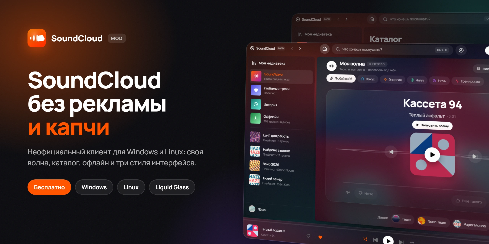
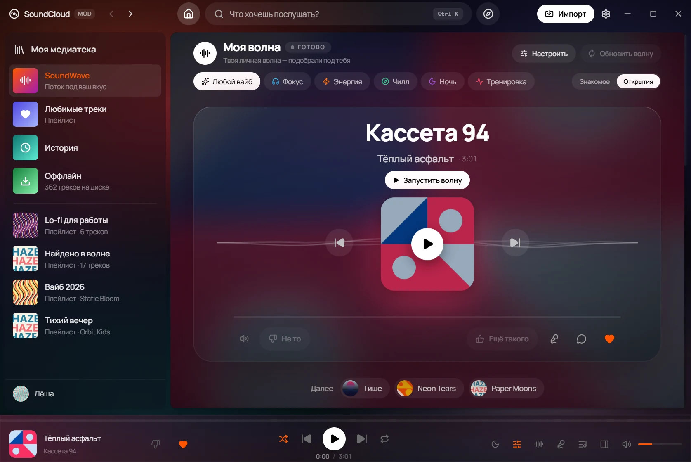
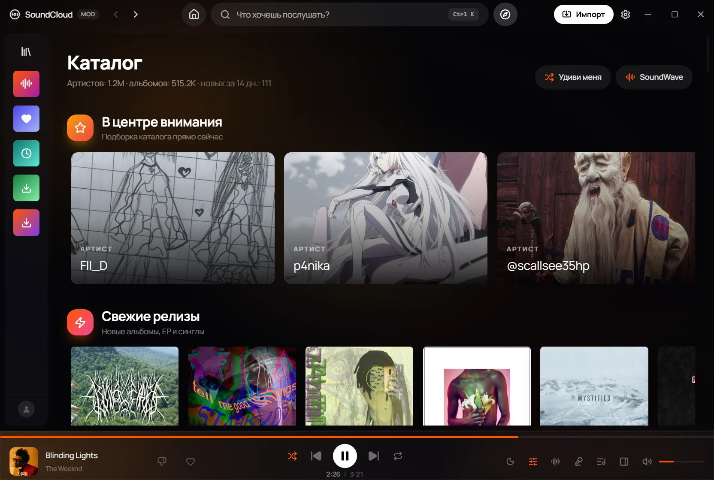
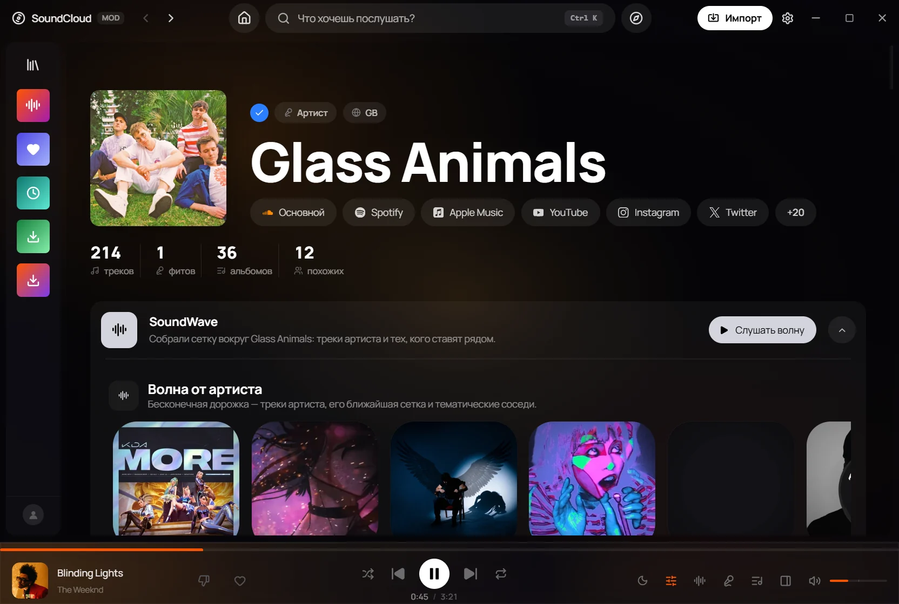
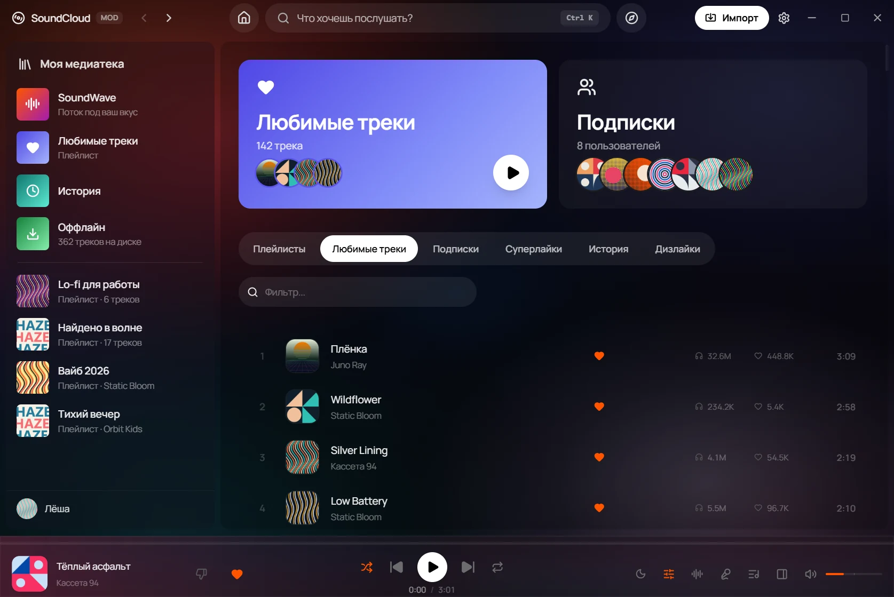
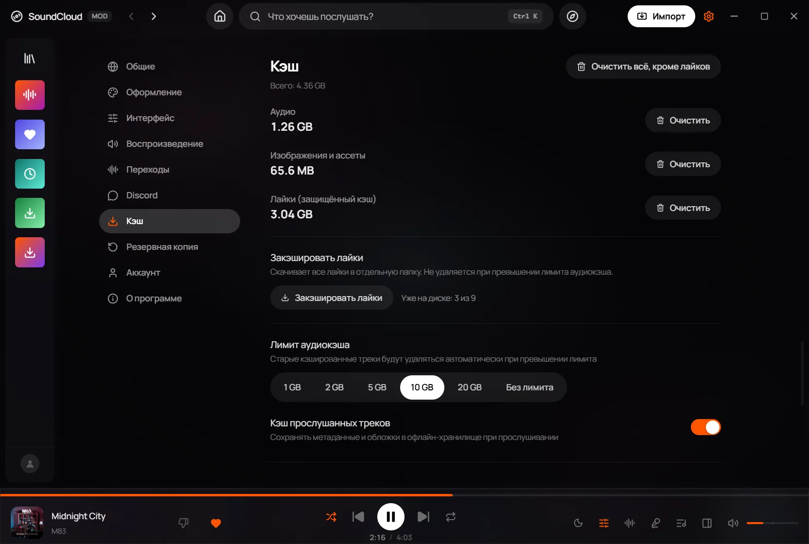
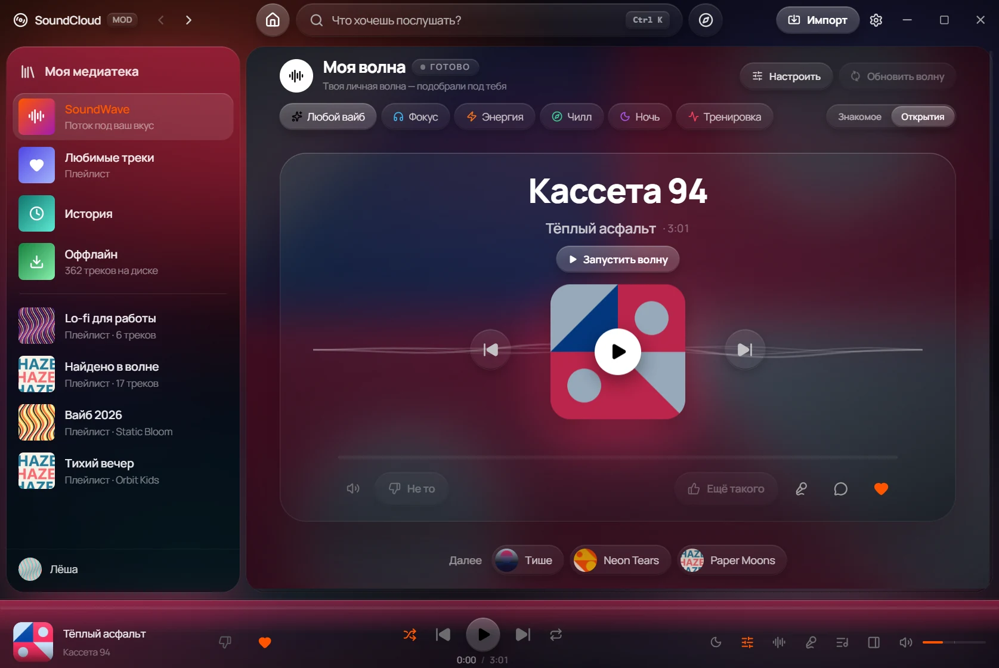
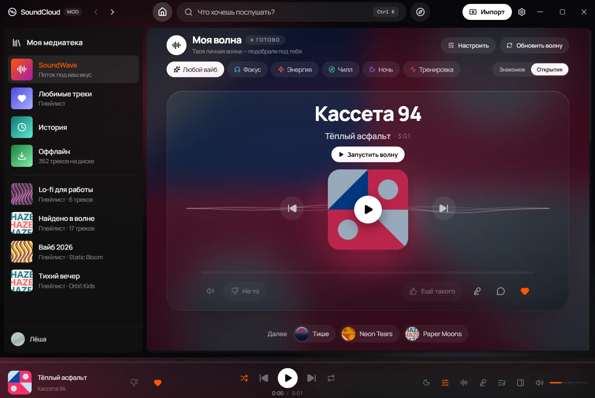

<div align="center">



<br/>

[](https://github.com/LazerProOk1/soundcloud_mod/releases/latest)
[](https://github.com/LazerProOk1/soundcloud_mod/releases/latest)
[](https://github.com/LazerProOk1/soundcloud_mod/releases/latest)
[](LICENSE)

Неофициальный клиент SoundCloud для Windows и Linux.<br/>
Без рекламы и капчи, работает в России.

[Скачать](https://github.com/LazerProOk1/soundcloud_mod/releases/latest) ·
[Сообщить о проблеме](https://github.com/LazerProOk1/soundcloud_mod/issues)

</div>



## Возможности

- **Моя волна.** Бесконечный поток под ваш вкус с режимами «Фокус», «Энергия», «Чилл», «Ночь»,
  «Тренировка». Кнопки «Не то» и «Ещё такого» меняют то, что будет дальше. Волну можно запустить
  от любого артиста.
- **Каталог.** Новые релизы, артисты в тренде, чарты по жанрам, релизы по годам и рекомендации
  по вашим лайкам.
- **Медиатека.** Лайки, плейлисты, подписки, история, суперлайки и дизлайки. Понравившиеся чужие
  плейлисты можно закрепить в боковой панели.
- **Офлайн.** Прослушанные треки кэшируются, лайки можно скачать целиком — без сети играет то,
  что уже на диске.
- **Звук.** Собственный движок на Rust: 10-полосный эквалайзер, кроссфейд, обрезка тишины,
  выравнивание громкости, скорость воспроизведения, таймер сна.
- **Текст песен** с синхронизацией по строкам.
- **Импорт** плейлистов и лайков из Spotify и Яндекс Музыки.
- **Обновления** ставятся из приложения (установщик на Windows, AppImage на Linux).
- **Discord** показывает, что сейчас играет.

<p align="center">
  
  
</p>
<p align="center">
  
  
</p>

## Стили интерфейса

Три стиля панелей на выбор в «Настройки → Интерфейс», плюс цвет акцента, обои, шрифт и масштаб.

<p align="center">
  
  
  
</p>
<p align="center"><sub>Liquid Glass · Матовое стекло (по умолчанию) · Просто</sub></p>

## Установка

Файлы — на странице [последнего релиза](https://github.com/LazerProOk1/soundcloud_mod/releases/latest).

| Система | Файл | Примечание |
|---|---|---|
| Windows 10 / 11 | `installer-windows-x64.exe` | Обновляется сам. При предупреждении SmartScreen: «Подробнее» → «Выполнить в любом случае». |
| Windows 10 / 11 | `portable-windows-x64.zip` | Без установки, обновлять вручную. |
| Linux | `x86_64.AppImage` | `chmod +x` и запустить. Обновляется сам. |
| Ubuntu / Debian | `amd64.deb` | `sudo apt install ./soundcloud-mod-*.deb` |
| Fedora / openSUSE | `x86_64.rpm` | `sudo dnf install ./soundcloud-mod-*.rpm` |

## Горячие клавиши

| Клавиша | Действие | Клавиша | Действие |
|---|---|---|---|
| `Space` | Пауза / воспроизведение | `Q` | Очередь |
| `←` / `→` | Перемотка на ±5 с | `L` | Текст песни |
| `↑` / `↓` | Громкость | `[` | Боковая панель |
| `N` / `P` | Следующий / предыдущий трек | `F11` | Полный экран |
| `S` / `R` | Перемешивание / повтор | `Ctrl + K` | Поиск |
| `M` | Выключить звук | `Ctrl + /` | Все горячие клавиши |

## Вопросы

**Нужен ли VPN?** Нет, запросы к SoundCloud идут через прокси.

**Безопасно ли для аккаунта?** Приложение не ставит лайки и не подписывается само — только по
вашему действию.

**Где хранятся данные?** Только на вашем компьютере. Резервную копию настроек можно сохранить в
«Настройки → Резервная копия».

## Сборка

Tauri 2, React 19, TypeScript, Tailwind CSS 4, аудиодвижок на Rust (`rodio`, Symphonia).
Нужны Node.js 22+, pnpm 10+ и Rust stable.

```bash
git clone https://github.com/LazerProOk1/soundcloud_mod.git
cd soundcloud_mod/desktop
pnpm install
pnpm tauri dev
```

Проверки и правила для кода — в [AGENTS.md](AGENTS.md).

## Благодарности

Основано на [SoundCloud-Desktop](https://github.com/zxcloli666/SoundCloud-Desktop) (MIT).
Тексты песен — [LRCLib](https://lrclib.net). Проект развивает один человек в свободное время.

## Лицензия

[MIT](LICENSE). Проект не связан с SoundCloud; SoundCloud — товарный знак SoundCloud Global
Limited & Co. KG. Скриншоты сняты в приложении на вымышленных треках и обложках.
