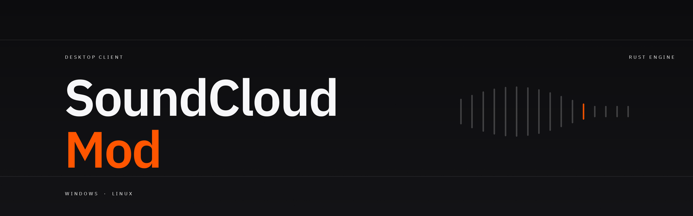

<div align="center">



<br/>

[](https://github.com/LazerProOk1/soundcloud_mod/releases/latest)
[](https://github.com/LazerProOk1/soundcloud_mod/releases/latest)
[](https://github.com/LazerProOk1/soundcloud_mod/releases/latest)
[](https://tauri.app)
[](https://react.dev)
[](https://www.rust-lang.org)
[](LICENSE)

Десктопный клиент SoundCloud для Windows и Linux: без браузера, рекламы и вкладок.
Свой аудиодвижок на Rust, офлайн-кэш треков, синхронизированный текст и персональная волна.

</div>

## Содержание

- [Возможности](#возможности)
- [Горячие клавиши](#горячие-клавиши)
- [Установка](#установка)
- [Сборка из исходников](#сборка-из-исходников)
- [Технологии](#технологии)
- [Структура репозитория](#структура-репозитория)
- [Лицензия](#лицензия)

## Возможности

### Плеер

- Собственный движок на `rodio` и Symphonia: MP3, OGG, Opus и AAC/MP4 без браузерного `<audio>`.
- **10-полосный эквалайзер** (32 Гц – 16 кГц) с пресетами, ReplayGain и кроссфейдом.
- Скорость воспроизведения, таймер сна, повтор, перемешивание, перемотка колесом мыши (`Shift` — по 15 с).
- Медиаклавиши через `souvlaki`, управление из системного трея и полноэкранный режим.
- **Discord Rich Presence**: трек, исполнитель, обложка и таймер.

### Интерфейс

- Стеклянные панели поверх живого градиента; палитра интерфейса подстраивается под обложку трека.
- Режим **No-Glass** без размытия — для слабых машин и тех, кому нужна максимальная производительность.
- Панель «Сейчас играет» справа, полноэкранный плеер и компактный режим окна.
- Темы оформления, аура оформления, свои обои, шрифты (системные или из файла), пользовательский CSS.
- Масштаб интерфейса (`Ctrl` + колесо), русский и английский языки.

### Библиотека и офлайн

- Лайки, плейлисты, подписки, история прослушиваний; суперлайки, дизлайки и собственный порядок любимых треков.
- **Кэш треков** с предзагрузкой очереди: параллельная загрузка HLS и progressive, пролайканные треки защищены от вытеснения.
- Список офлайн-треков и работа без сети на закэшированном материале.
- Импорт по ссылке из SoundCloud, Zaycev и YouTube; сохранение трека в файл; резервная копия профиля.

### Волна, текст и вход

- **SoundWave** — бесконечная персональная волна от трека или исполнителя, с настройкой языков, скрытием прослушанного и обратной связью.
- Синхронизированный текст: построчная анимация, переход по строке, FFT-визуализатор (LRCLib и SoundCloud).
- Вход в аккаунт SoundCloud или по **QR-коду** с телефона.
- Ссылка SoundCloud, вставленная в поиск, открывается внутри приложения.

## Горячие клавиши

| Клавиша | Действие | Клавиша | Действие |
|---|---|---|---|
| `Space` | Пауза / воспроизведение | `Q` | Очередь |
| `←` / `→` | Перемотка на ±5 с | `L` | Текст песни |
| `↑` / `↓` | Громкость (ускоряется при удержании) | `[` | Боковая панель |
| `N` / `P` | Следующий / предыдущий трек | `F11` | Полный экран |
| `S` / `R` | Перемешивание / повтор | `Esc` | Закрыть панель |
| `M` | Выключить звук | `/` или `Ctrl + K` | Поиск |
| `Ctrl + /` | Все горячие клавиши | | |

## Установка

Готовые сборки — на странице [Releases](https://github.com/LazerProOk1/soundcloud_mod/releases/latest).

**Windows 10 / 11 (x64)**

| Файл | Что это |
|---|---|
| `*-installer-windows-x64.exe` | Установщик, рекомендуется: дальше приложение обновляется само. При предупреждении SmartScreen — «Подробнее» → «Выполнить в любом случае». |
| `*-windows-x64.msi` | MSI-пакет для развёртывания. |
| `*-portable-windows-x64.zip` | Портативная версия (обновлять вручную): распаковать и запустить `SoundCloud Mod.exe`. |

**Linux (x64)**

| Файл | Что это |
|---|---|
| `*.deb` | `sudo apt install ./SoundCloud*.deb` — Ubuntu, Debian |
| `*.AppImage` | `chmod +x SoundCloud*.AppImage && ./SoundCloud*.AppImage` |
| `*.rpm` | `sudo dnf install ./SoundCloud*.rpm` — Fedora, openSUSE |

Flatpak собирается из манифеста [`.github/flatpak/io.github.LazerProOk1.soundcloudmod.yml`](.github/flatpak/io.github.LazerProOk1.soundcloudmod.yml).

**Требования:** Windows 10/11 x64 с WebView2 Runtime или Linux x64 с `libwebkit2gtk-4.1`; около 200 МБ на диске. Приложение ставится с отдельным идентификатором `com.lazerprook1.soundcloudmod` и хранит настройки и кэш отдельно от других клиентов.

## Сборка из исходников

Нужны **Node.js 20+**, **pnpm 10+** и **Rust (stable)**.

```bash
git clone https://github.com/LazerProOk1/soundcloud_mod.git
cd soundcloud_mod/desktop
pnpm install
pnpm tauri dev     # запуск с hot-reload
```

Проверки и сборка:

```bash
pnpm check                         # Biome: линтер и формат
pnpm build                         # tsc + Vite
node --experimental-strip-types --test src/lib/__tests__/*.test.ts
pnpm tauri build                   # установщик в src-tauri/target/release/bundle/
```

## Технологии

| Слой | Что используется |
|---|---|
| Оболочка | Tauri 2, Rust 2021 |
| Интерфейс | React 19, TypeScript, Tailwind CSS 4 |
| Состояние и данные | Zustand, TanStack Query, dnd-kit |
| Аудио | `rodio`, Symphonia, Opus, 10-полосный EQ, ReplayGain, FFT-анализатор |
| Сборка | Vite, Biome, `cargo` |

## Структура репозитория

```text
soundcloud_mod/
├── desktop/                 # Приложение
│   ├── src/                 # React: страницы, компоненты, stores, lib
│   └── src-tauri/           # Rust: audio, track_cache, network, discord, tray
├── docs/                    # Материалы для README и аудиты кодовой базы
└── .github/                 # CI, Flatpak-манифест
```

## Лицензия

[MIT](LICENSE). Проект не связан с SoundCloud; SoundCloud — товарный знак SoundCloud Global Limited & Co. KG.
Синхронизированный текст предоставляется через [LRCLib](https://lrclib.net).
